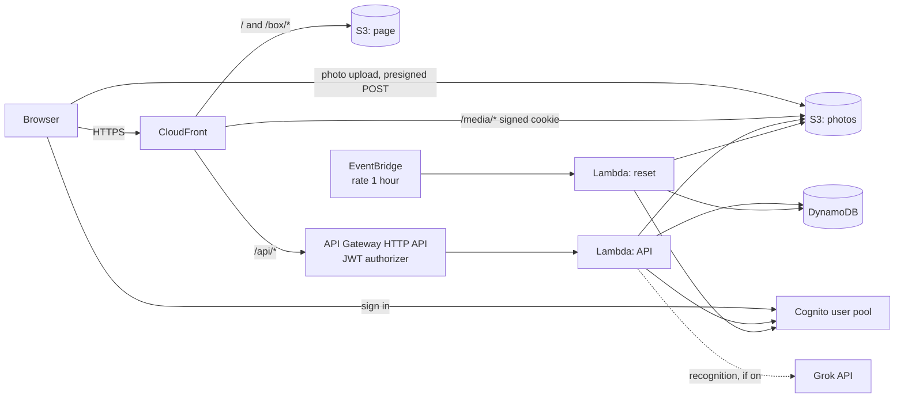

# inventory-serverless-aws

A home inventory of boxes, running serverless on AWS. Each box has a number, a description, a photo and a list of what is inside; search finds a box by any word from them. There is no server to patch and nothing runs while nobody uses it, so a small inventory costs a few cents a month.

Everything is stored in DynamoDB and S3 behind Cognito sign-in. Photos stay in a private bucket and reach the browser through CloudFront with a signed cookie.

## Demo

**https://dbpex5dl2nq28.cloudfront.net**

Sign in with `admin@example.com` / `admin123` (the fields are filled in for you).

The demo is public and wiped every hour: all boxes, photos, history and users go away, and the admin password is put back. Seven example boxes — four with photos — are written again after each wipe, so they are always there. Invitations do not send email in the demo; the temporary password is shown to the administrator instead. Photo recognition is off in the demo (see below).

## Features

- Boxes with a number (`12`, `A-7`), a description and contents in Markdown; a card per box at `/box/<number>` that can be shared, reloaded or opened in a new tab.
- Search across number, description and contents, every word has to match; `ё` counts as `е`, accented words stay whole.
- The list is sorted by index (the box number from `/box/<index>`, with `A-9` before `A-10`), by name (the first line of the description), or with the recently changed or the newest boxes first; the choice is remembered in the browser.
- Photos: pick a file (on a phone the picker also offers the camera) or paste with ⌘V / Ctrl+V. The browser keeps a 2560 px JPEG for viewing and a 1280 px one for the list; a portrait photo is turned to lie horizontally, and ↺ ↻ turn a saved one while editing the card. A photo gallery view and a full-screen viewer.
- History of every change of the contents and of the photo description written by recognition: before, after, who and an optional comment. Administrators can delete single entries.
- Search in the history, off by default: with the "in history" box ticked, search also finds a box by what it used to hold or what its earlier photos showed, and marks such a box "found in history".
- Optional photo recognition: with a user's own Grok API key the photo is described into hidden text that search uses.
- Optional two-factor authentication with an authenticator app (TOTP), turned on or off in the settings by each user. Changing the password asks for the new one twice.
- Labels to print on A4 (Settings → Labels): a QR code linking to the card with the box number and/or name in the largest letters that fit; the label size (30 × 50 mm by default) and the font are chosen there and remembered.
- Settings for administrators: invite, disable and delete users, see who has two-factor authentication and reset it for a lost phone.
- Keyboard: ⌘Enter / Ctrl+Enter saves a card, I edits it, J and L go to the previous and the next box, Esc leaves editing (asking if anything changed) or closes the card.
- Settings → Version: the version of the site and the releases of the demo repository that came after it, with their notes.
- Interface in English, Russian, French and Italian, following the system language.

The page builds DOM nodes itself: text and Markdown never become HTML that runs.

## Architecture



| Part | Service |
| --- | --- |
| Page | S3 + CloudFront (default `*.cloudfront.net` domain and certificate); a CloudFront function serves `/box/*` from `index.html` |
| Sign-in | Cognito user pool, no self sign-up, optional TOTP |
| API | API Gateway HTTP API with a Cognito JWT authorizer, Lambda (Python, arm64) |
| Boxes, history, settings | DynamoDB on demand, one table |
| Photos | Private S3 bucket; uploads with a five-minute presigned POST, reads through CloudFront `/media/*` with a one-hour signed cookie |
| Demo reset | Lambda `reset.py`, EventBridge rule `rate(1 hour)` |

## What it costs

Nothing runs between requests, and most services fall within the AWS always-free allowances (Lambda 1M requests and 400,000 GB-s, CloudFront 1 TB and 10M requests, Cognito 10,000 monthly active users, DynamoDB 25 GB storage, CloudWatch Logs 5 GB). What remains is paid per request.

Estimate for **light use** — a handful of people, 200 boxes, 20,000 API calls, 2 GB of photos and 5 GB of traffic a month — at `eu-central-1` list prices:

| Service | Usage | Price | Per month |
| --- | --- | --- | --- |
| Lambda (API + 720 hourly resets) | ~21,000 invocations, 256 MB | free allowance | $0.00 |
| API Gateway HTTP API | 20,000 requests | ~$1.20 per million | $0.02 |
| DynamoDB on demand | 1,000 writes, 50,000 reads, < 1 GB | ~$0.76 / $0.15 per million, storage free | $0.01 |
| DynamoDB point-in-time recovery | < 0.1 GB | ~$0.24 per GB | < $0.01 |
| S3 (page + photos) | 2 GB, ~10,000 requests | ~$0.0245 per GB | $0.05 |
| CloudFront | 5 GB, 100,000 requests | free allowance | $0.00 |
| Cognito, TOTP included | < 10,000 active users | free allowance | $0.00 |
| CloudWatch Logs | < 1 GB | free allowance | $0.00 |
| **Total** | | | **≈ $0.10** |

Photo recognition is billed by xAI to the key's owner, per photo. A WAF web ACL is left out on purpose: it alone would cost about $5–6 a month.

Prices are approximate and change over time; check the AWS pricing pages for your region.

## Deploy

### What you need

1. An S3 bucket for Terraform state. The workflow uses the S3 backend with the native lockfile (Terraform 1.10+), so no DynamoDB lock table is needed; the state key is `inventory-serverless-aws/terraform.tfstate`.
2. The GitHub OIDC provider in the AWS account (`https://token.actions.githubusercontent.com`, audience `sts.amazonaws.com`) and a role for this repository that trusts only jobs of the GitHub environment `demo`:

   ```json
   {
     "Effect": "Allow",
     "Principal": { "Federated": "arn:aws:iam::<account>:oidc-provider/token.actions.githubusercontent.com" },
     "Action": "sts:AssumeRoleWithWebIdentity",
     "Condition": {
       "StringEquals": {
         "token.actions.githubusercontent.com:aud": "sts.amazonaws.com",
         "token.actions.githubusercontent.com:sub": "repo:<owner>/inventory-serverless-aws:environment:demo"
       }
     }
   }
   ```

   Its permissions: everything named with the `inventory-serverless` prefix (the `name` variable: buckets, the table, functions, roles with `iam:PassRole`, log groups, SSM parameters, the EventBridge rule), API Gateway, Cognito and CloudFront (their ids are generated), log delivery for API access logs, and the state objects under the state key prefix.
3. In the GitHub repository: the environment `demo`, and the variables `AWS_ROLE_ARN` (the role) and `TF_STATE_BUCKET` (the state bucket). There are no secrets. Optionally `ACCESS_LOGS_BUCKET`: the CI passes it as `access_logs_bucket`, and the CloudFront access logs of the site go there (see [Access logs](#access-logs)); the role then also needs log delivery in `us-east-1` (`logs:PutDeliverySource`, `PutDeliveryDestination`, `CreateDelivery` and their `Get`/`Delete`/`Describe` on names with the prefix) and `s3:GetBucketPolicy` on that bucket.

### GitHub Actions

[`.github/workflows/terraform.yml`](.github/workflows/terraform.yml) only calls the shared workflow of [Tozapid/demo-ci-cd-skeleton](https://github.com/Tozapid/demo-ci-cd-skeleton); the same caller and the same jobs serve Hide-My-Email, inventory-serverless-aws and wiki-serverless-aws:

- every push and pull request, three jobs side by side: `terraform fmt` and `terraform validate`; the Lambda tests; the page's syntax check and its tests, where there are any;
- pull requests from this repository: `terraform plan` in the environment `demo`, summary in the run;
- a preview of a pull request, by hand: Run workflow with `preview` = its number deploys its last push once more as `inventory-serverless-pr<number>`, with its own state, and comments the address on it; it is destroyed when the pull request is merged or closed, by hand (`destroy`), or by the daily sweep, which also takes those not deployed for a week;
- a push to `main` or a manual run: plan and apply in the environment `demo`. The job stops if the plan would destroy or replace a bucket, the table or the user pool; such a change has to be applied by hand. A manual run from another branch (Actions → terraform → Run workflow, pick the branch) deploys that branch the same way, over the same site: handy to try a change on the demo before merging. The next push to `main` puts main back. Applies run one at a time across branches.
- after `main` is deployed: the GitHub release of the newest `CHANGELOG.md` entry, once (see [Versions and releases](#versions-and-releases)). The caller grants `contents: write` for it.

`main` takes changes only through pull requests, merged by squash once the three checks pass (`ci / Terraform format and validate`, `ci / Lambda tests`, `ci / Frontend tests`); the branch is deleted after the merge.

The jobs get AWS credentials from GitHub's OIDC token (`permissions: id-token: write`, `aws-actions/configure-aws-credentials` with `role-to-assume`): no AWS key is stored anywhere, and a token lives for one job.

The site address is printed in the run summary and in `terraform output site_url`.

### Versions and releases

Every entry of [`CHANGELOG.md`](CHANGELOG.md) starts with its version, optionally followed by a date or a title: `## v1.4.0`, `## v1.4.0 — 2026-10-12` or `## v1.4.0 — versions`. Inside an entry the changes go under `### Added`, `### Changed`, `### Fixed` and `### Security`, newest entry first. A pull request that changes the site adds an entry with a higher version: minor for a feature, patch for a fix. The check `ci / Terraform format and validate` refuses a newest entry without one.

- The site takes its version from the newest entry when Terraform deploys it (`local.version` in `lambda.tf`).
- After `main` is deployed, the job `ci / Release` makes the tag and the GitHub release of the newest entry, with its text as the notes, unless that version is out already. A pull request without a new entry releases nothing.
- Settings → Version shows the version and the releases of `releases_repository` (this repository by default) that came after it. The API (`GET /api/version`) reads them from the Atom feed of the GitHub releases (`https://github.com/<repository>/releases.atom`) and keeps them an hour. It does not use the REST API, whose hourly limit without a token is shared by every function behind Lambda's addresses. A copy deployed from a fork can compare itself with this repository by naming it in `releases_repository`; an empty value turns the check off.

### From a workstation

```bash
terraform init \
  -backend-config="bucket=<state bucket>" \
  -backend-config="key=inventory-serverless-aws/terraform.tfstate" \
  -backend-config="region=eu-central-1"
terraform apply
```

### Demo or private inventory

The defaults set up the public demo. For a private inventory, change them in a `terraform.tfvars`:

| Variable | Demo | Private inventory |
| --- | --- | --- |
| `demo` | `true` — the sign-in screen shows and fills in the admin sign-in | `false` — nothing is shown |
| `admin_email`, `admin_password` | `admin@example.com`, `admin123` | your own |
| `reset_schedule` | `rate(1 hour)` | `""` — no reset and no example boxes |
| `invite_emails` | `false` | `true` — Cognito emails the invitation |
| `recognition` | `false` | `true` — each user may set a Grok API key |
| `password_min_length` | `8` | `12` or more |
| `photo_max_bytes` | 6 MB | up to what you are ready to store |

A custom domain needs an ACM certificate in `us-east-1` and an alias on the distribution; see the comment at `viewer_certificate` in `cloudfront.tf`.

### Photo recognition

With `recognition = true`, the settings get a Recognition tab where each user stores their own xAI Grok API key and model. After a photo is saved, the API calls itself asynchronously, sends the 1280 px copy to Grok and stores the description as hidden text: it is searchable but not shown on the card unless asked for. The description is written in the language of whoever uploaded the photo. Each new description, and the old one going away with a replaced photo, is written to the history of the box.

The key is write-only: the page only learns that a key is saved and its last four characters. Below the key, the tab shows the user's recognition log: the last 50 attempts over 30 days, with what Grok answered when it failed. Administrators can switch it to everyone's attempts.

It is off in the public demo for a reason: everybody signs in as the same administrator, so a key saved there would be spent by the next visitor; the key cannot be read back, but anyone signed in as that admin can upload photos on it. The example boxes carry hidden text of their own, so searching for `spanners` or `rolls` still shows what recognition does.

## Access logs

Off by default. With `access_logs_bucket` set (the repository variable `ACCESS_LOGS_BUCKET` in CI), `access-logs.tf` turns on the standard logs (v2) of CloudFront: CloudWatch delivers a gzipped JSON line per request from `us-east-1` to `cloudfront/<name>/<yyyy>/<MM>/<dd>/` of that bucket, at no charge for the delivery to S3. A line holds the date and time, the address and country of the viewer, the method, path, status, bytes, time taken, referrer, user agent, cache result and host.

The bucket is yours, in the same account: its policy has to let `delivery.logs.amazonaws.com` put objects under `cloudfront/` (and read the bucket ACL), conditioned on the account. [account-serverless-aws](https://github.com/Tozapid/account-serverless-aws) reads such a bucket and shows the traffic of each site.

## Repository layout

| Path | What is there |
| --- | --- |
| `*.tf` | Terraform |
| `web/` | The page: `app.js` (interface), `i18n.js` (translations), `styles.css`, `index.html` |
| `lambda/lambda_app.py` | API, with tests in `lambda_app_test.py` |
| `lambda/reset.py` | Hourly demo reset, with tests in `reset_test.py` |
| `seed/` | Example boxes of the demo (`boxes.json`) and their photos, uploaded to `seed/photos/` in the photo bucket |
| `cloudfront/` | CloudFront functions: `routes.js` (card addresses), `media.js` (photo paths), `api_host.js` (site address for the photo cookie) |
| `tests/web/` | Frontend tests |
| `.github/workflows/` | CI and deployment |

## Tests

```bash
cd lambda && python -m unittest -v lambda_app_test reset_test
cd tests/web && npm ci && npm test
```

**Lambda** (`lambda/*_test.py`, Python `unittest`). The handlers run against in-memory stand-ins for DynamoDB, S3 and Cognito, with requests built the way API Gateway sends them:

- search: folding, tokens, hidden photo text, accented words;
- identity: only a verified email names the user, so nobody reads another user's settings;
- error messages in the page language, field names included;
- administration: only the `admins` group gets in, invite (with and without email), disable, delete, reset two-factor authentication, no locking yourself out;
- recognition switched off: no key handed out or saved, nothing queued;
- CloudFront cookie signing, checked byte for byte against `openssl`;
- the demo reset: wipes the table, every photo version and other users, brings the admin back with two-factor authentication off and writes the example boxes and their history again, keeping their photos; every example photo exists.

**Frontend** (`tests/web/`, `node --test`):

| File | What it checks |
| --- | --- |
| `i18n.test.js` | Every interface string has English, French and Italian text with the same `{placeholders}`, and no Russian text reaches the page without `t()`; the system language is picked unless one was chosen. |
| `ui.test.js` | The page in headless Chrome against an in-memory API filled with the example boxes: demo sign-in, the example photos and a card opened by its address, search by hidden photo text, creating a box, the code step at sign-in, two-factor authentication in the settings with a real QR code (its integrity hash checked), recognition settings shown only when on, invitations without email and 2FA reset in the users list, switching language. Chrome is found on the usual paths or taken from `CHROME_PATH`; without it these tests are skipped locally and fail in CI. |

## Limits

- Everyone signed in sees and edits every box; there are no per-box permissions.
- Search scans the table with a filter, which is fine for thousands of boxes, not for millions.
- The Cognito invitation email has one language for the whole pool (English).
